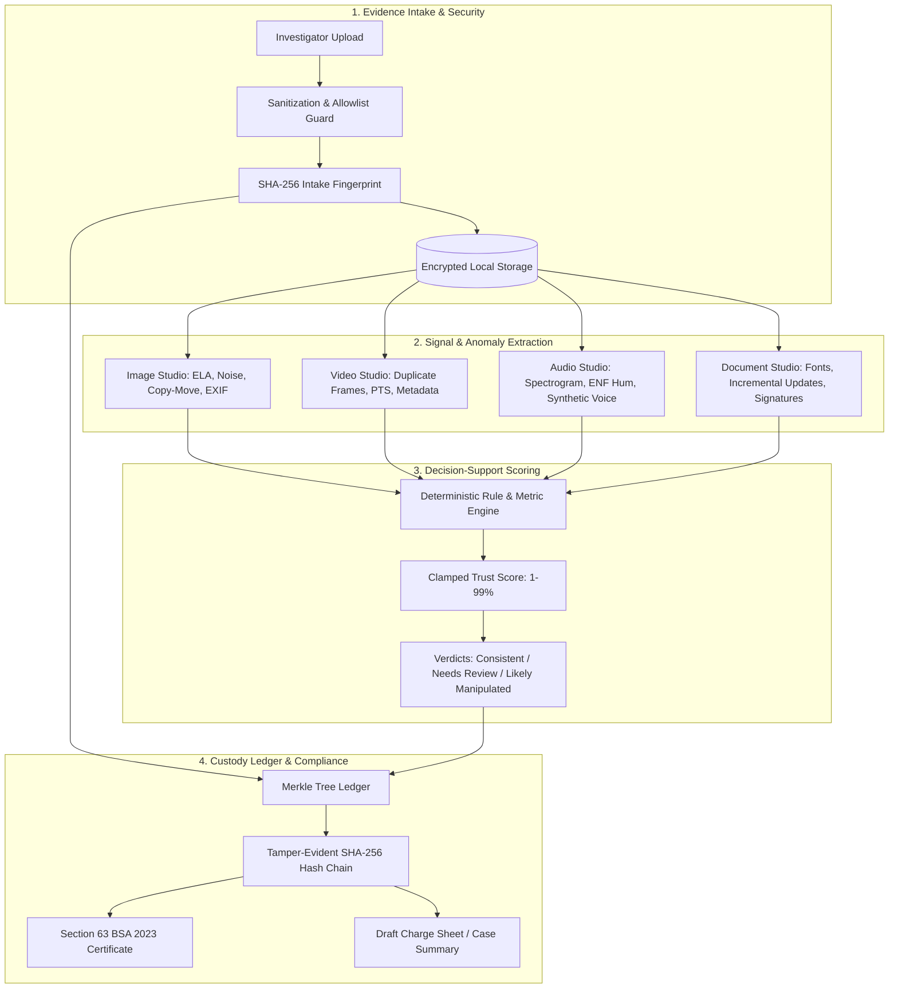

# Evidence Integrity Platform (EIP)

> **Digital evidence, verified.** An end-to-end digital forensics, cryptographic chain-of-custody, and decision-support platform engineered for Indian law enforcement, cyber cells, and forensic examiners under **Section 63 of the Bharatiya Sakshya Adhiniyam (BSA), 2023** *(formerly Section 65B of the Indian Evidence Act)*.

---

## 🏛️ System Overview

The **Evidence Integrity Platform** provides a tamper-evident environment for intake, cryptographic hashing, forensic anomaly detection, and automated court-admissible certificate generation for digital evidence (images, audio, video, documents, and spreadsheets).



---

## ⚡ Quick Start

### Option 1: Docker (Single-Command Run)

Run both the FastAPI backend and React frontend production build in an isolated container:

```bash
docker compose up --build
```
Open **`http://localhost:8000`** in your browser.

---

### Option 2: Local Development Setup

#### Prerequisites
* **Python 3.10+** (tested on 3.11, 3.12, 3.14)
* **Node.js 18+** and **npm**
* **FFmpeg & FFprobe** on PATH (for audio and video spectrogram analysis)

#### 1. Backend Setup
```bash
cd backend
python -m venv .venv
# On Windows:
.venv\Scripts\activate
# On Linux/macOS:
source .venv/bin/activate

pip install -r requirements.txt
cp .env.example .env

# Initialize database and run server
python -m uvicorn app.main:app --host 127.0.0.1 --port 8000 --reload
```

#### 2. Frontend Setup
```bash
cd frontend
npm install
npm run dev
```
Open **`http://localhost:5173`** to access the Vite developer server.

---

## 🔑 Default Sign-in Credentials

| Role | Username | Password | Permissions |
|------|----------|----------|-------------|
| **Admin** | `Krishna` | `Krishna@0305` | Full system control, user management, audit review, case deletion |
| **Forensic Specialist** | `nida` | `Nida@2026` | Case creation, evidence upload, deep forensic inspection |
| **Investigator** | `meera` | `ram@1234` | Evidence inspection, report generation, team case assignment |

---

## 🧪 Automated Test Suite

A dedicated `/tests` test suite covers hashing, Merkle tree operations, scoring neutrality, and server-side role enforcement:

```bash
# Run pytest from root directory
pytest tests/ -v
```

### What the test suite verifies:
* **`tests/test_hashing.py`**: Validates chunked SHA-256 hashing, collision resistance, and zero-byte consistency.
* **`tests/test_merkle.py`**: Verifies deterministic Merkle root generation, leaf count, tamper detection, and endpoint integrity.
* **`tests/test_scoring.py`**: Validates scoring clamping (1-99%, never flat 0% or 100%), signal penalties, verdict bands, and strict filename neutrality (scores are calculated from forensic signals, not filenames).
* **`tests/test_permissions.py`**: Verifies unauthenticated blocks (401), Viewer read-only restrictions (403 on uploads), Investigator permission boundaries (403 on user creation), and Admin privileges.

---

## 🔍 Core Capabilities & Features

### 1. Photo and Video Forensic Studio
* **Error Level Analysis (ELA)**: Re-compression difference heatmaps pinpointing localized digital alterations.
* **Noise Inconsistency Analysis**: High-frequency residual filtering to uncover spliced objects with mismatched sensor noise.
* **Copy-Move & Clone Detection**: Feature-matching keypoints identifying duplicated or cloned regions.
* **Video Duplicate-Frame & Freeze Detection**: Identifies repeated or dropped frames, hard cuts, and PTS timestamp desyncs.
* **EXIF & Container Metadata**: Audits camera serial numbers, GPS metadata, editing software signatures, and quantization tables.

### 2. Audio & Voice Forensic Studio
* **High-Resolution Spectrogram**: Frequency-domain visualization up to 22 kHz for speech analysis.
* **Electrical Network Frequency (ENF)**: Compares 50 Hz power-grid hum harmonics against chronological grid logs.
* **Synthetic Voice / TTS / Cloning Flags**: Identifies vocoder artifacts, artificial silence, and synthetic speech characteristics.

### 3. Document & Record Forensics
* **PDF Structural Analysis**: Detects incremental updates, trailer alterations, font embedding discrepancies, and white-out covered text layers.
* **Spreadsheet & Word Audit**: Tracks author history, revision metadata, and macro alterations.

### 4. Cryptographic Custody Ledger & BSA Compliance
* **Merkle Tree Proofs**: Cryptographically anchors all case files under a unified mathematical root hash.
* **Section 63 BSA (2023) Certificate Generator**: Automatically drafts formal compliance certificates specifying hashing algorithms, equipment serials, custodial timelines, and statutory certifications under Section 63 BSA (formerly Section 65B IEA).
* **Draft Charge Sheet / Case Summary**: Summarizes case findings, suspect devices, and forensic metrics into court-ready formats.

### 5. Security & Privacy Architecture
* **Server-Enforced RBAC**: Roles (Admin, Investigator, Viewer) are verified strictly at the API layer.
* **2FA Two-Factor Authentication**: RFC 6238 TOTP with sliding-window brute-force rate limiting.
* **Upload Sanitization**: Rejects path traversals, control characters, null bytes, and non-whitelisted extensions with a 500 MB ceiling.
* **Offline Air-Gapped Mode**: When external AI is toggled off in Settings, zero file or prompt data leaves the server; narrative summaries switch to deterministic local templates.
* **Immutable Audit Trail**: Append-only event ledger logging `login`, `upload`, `verdict`, `report_export`, and `role_change` with HTTP 405 blocking on edit/delete.

---

## ⚖️ Honest Limitations & Forensic Disclaimer

> [!IMPORTANT]
> **Decision-Support Tool Notice:**
> The Evidence Integrity Platform is a **decision-support platform** designed to highlight anomalies and accelerate digital investigations. Heuristic detectors and AI analysis are probabilistic. **The final expert opinion must always be rendered and testified to in court by a qualified, certified digital forensic examiner.**

* **Perceptual Compression**: Social media platforms (WhatsApp, Instagram, Telegram) recompress media upon transmission, stripping original EXIF metadata and introducing compression artifacts. The platform flags these recompressions for examiner attention rather than immediately concluding malicious intent.
* **Adversarial Post-Processing**: Advanced anti-forensic techniques (such as repeated re-quantization or synthetic noise injection) may reduce detector confidence; cross-modal verification (e.g. cross-referencing audio ENF with video frame rates) is recommended.

---

## 🗺️ Roadmap & Future Work

- [ ] Hardware Security Module (HSM) and PKCS#11 smart-card signing for Section 63 BSA certificates.
- [ ] Integration with state forensic science laboratory (FSL) case management systems (CCTNS/ICJS).
- [ ] Direct optical media (CD/DVD/Blu-ray) raw image ingestion and bitstream verification.
- [ ] Distributed blockchain anchoring (e.g., hyperledger-based state evidence registries).
